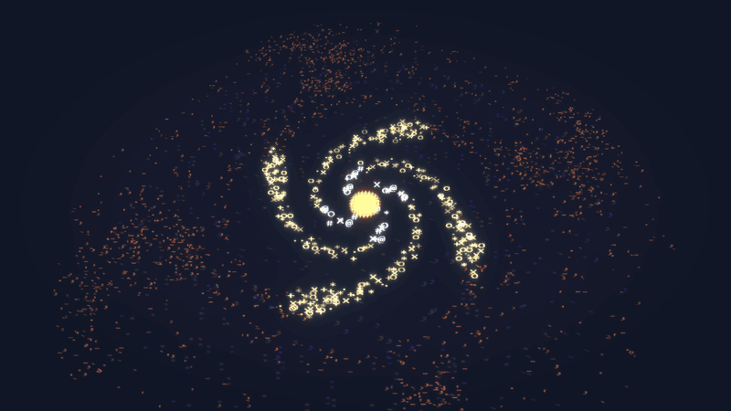
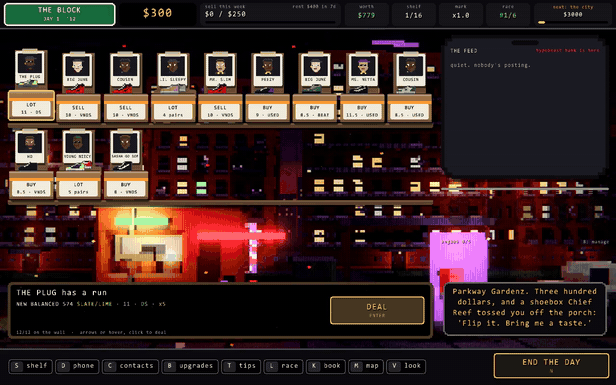
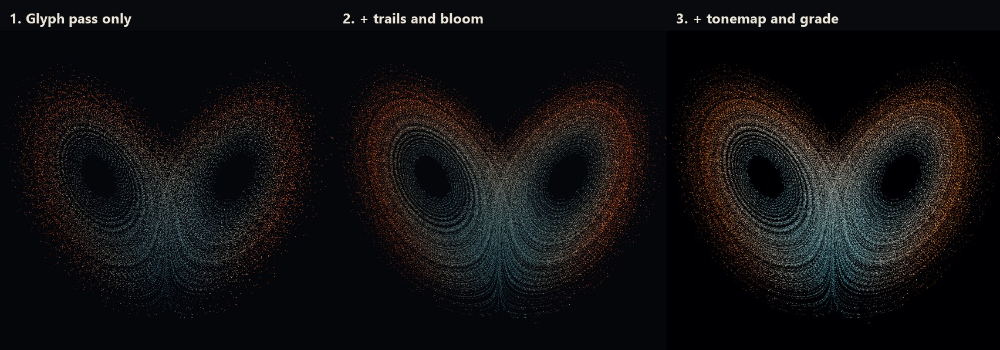
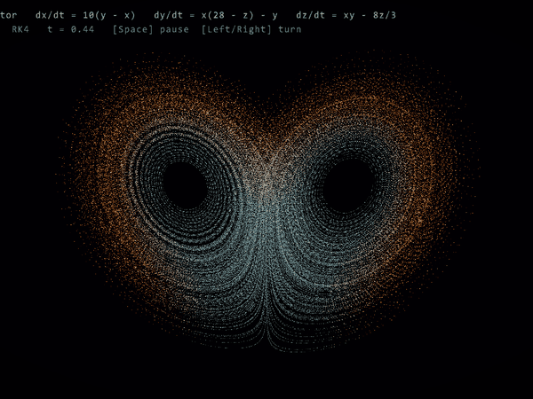
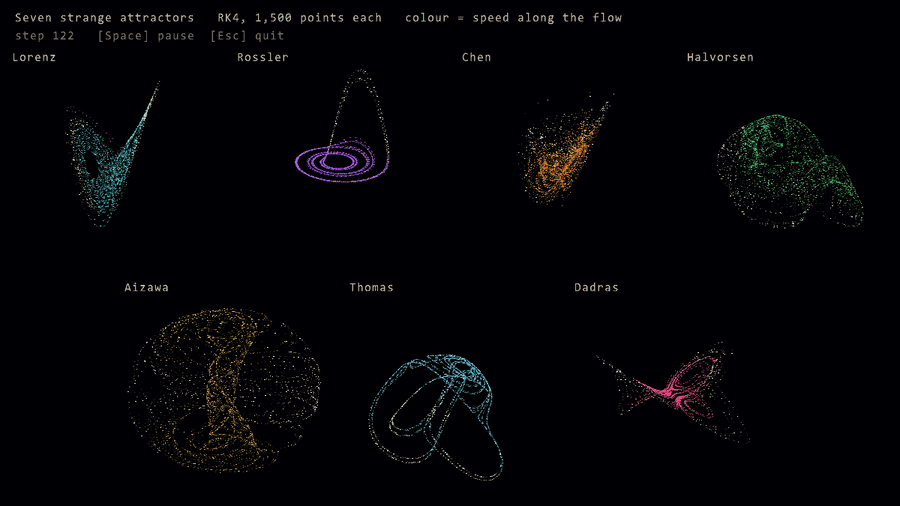
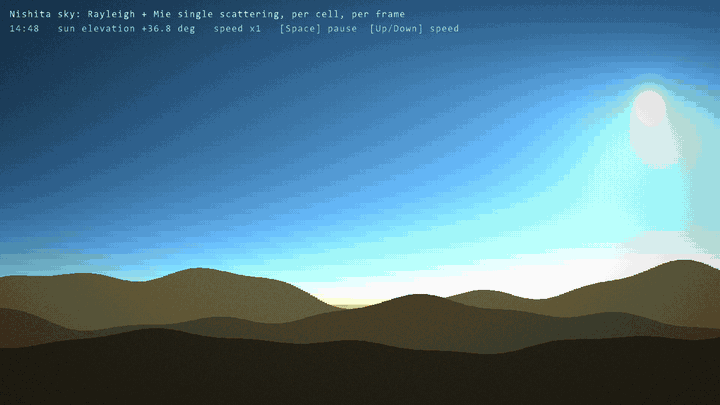
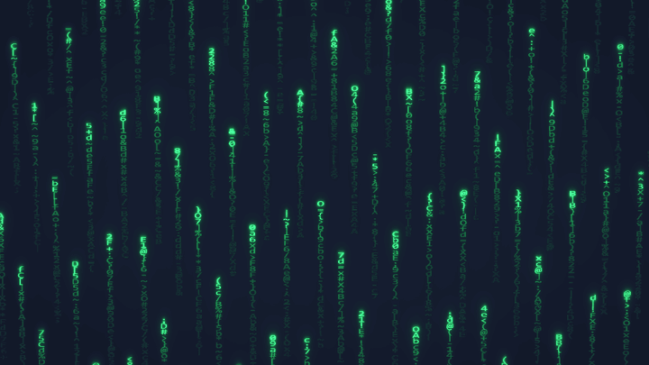
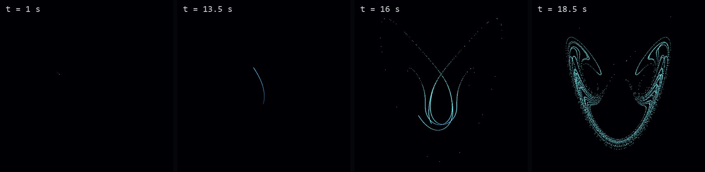

<!-- outcome-block -->
**Games where everything is particles and really breaks. No meshes. Destruction, cloth and fluid come from one spring-physics system.**

Mesh engines need a system per kind of damage. This uses one, with different spring constants. It runs CHAOS RPG and O'BLOCK (free on Steam).

If it doesn't do what this README says, [open an issue](https://github.com/Mattbusel/proof-engine/issues) and I'll fix it.
<!-- outcome-block -->

<h1 align="center">Proof Engine</h1>

<p align="center">English | <a href="README.zh-CN.md">简体中文</a> | <a href="README.ja.md">日本語</a> | <a href="README.ko.md">한국어</a></p>

<p align="center"><b>Write the equations. Proof Engine draws what they do, in real time, with HDR glow.</b></p>

<p align="center">A Rust graphics engine plus ready-to-run demos.</p>

<p align="center">
  <a href="https://gitlab.com/mattbusel/proof-engine/-/releases/permalink/latest/downloads/proof-lorenz.exe"><b>Download for Windows (.exe)</b></a> &nbsp;&middot;&nbsp;
  <a href="#download">macOS and Linux</a> &nbsp;&middot;&nbsp;
  <a href="https://store.steampowered.com/app/5357680/?utm_source=github&utm_medium=readme&utm_campaign=proof-engine-links"><b>Shipped game: O'BLOCK on Steam</b></a> &nbsp;&middot;&nbsp;
  <a href="https://proof-engine-rs.vercel.app/">Site</a> &nbsp;&middot;&nbsp;
  <a href="https://docs.rs/proof-engine">docs.rs</a> &nbsp;&middot;&nbsp;
  <a href="https://crates.io/crates/proof-engine"></a>
  &nbsp;<a href="https://github.com/Mattbusel/proof-engine/actions/workflows/ci.yml"></a>
  &nbsp;
</p>

<p align="center"></p>
<p align="center"><sub>The <code>galaxy</code> demo, recorded from the engine's own framebuffer.</sub></p>

Rust on OpenGL. Points and glyphs move by differential equations (Lorenz and six other strange attractors), force fields and physics. Then a half-float HDR pipeline draws them with bloom and an ACES tonemap.

## Shipped on Steam: O'BLOCK

[](https://store.steampowered.com/app/5357680/?utm_source=github&utm_medium=readme&utm_campaign=proof-engine)

I shipped **[O'BLOCK on Steam](https://store.steampowered.com/app/5357680/?utm_source=github&utm_medium=readme&utm_campaign=proof-engine)** on it. A sneaker-flipping roguelike: haggle with buyers who bluff, build a resale empire, don't draw heat. Free to play, so you can see the engine in a real release.

Shipping it meant adding Chinese, Japanese and Korean text to the glyph atlas: [Adding Chinese, Japanese and Korean text to a Rust OpenGL game engine](https://tensorust.com/articles/rust-game-engine-chinese-japanese-korean-text/?utm_source=github&utm_medium=readme&utm_campaign=proof-engine).

## Download

| System | Download |
| --- | --- |
| **Windows** | [**proof-lorenz.exe**](https://gitlab.com/mattbusel/proof-engine/-/releases/permalink/latest/downloads/proof-lorenz.exe): double-click it. Or [all 10 demos and the editor (.zip)](https://gitlab.com/mattbusel/proof-engine/-/releases/permalink/latest/downloads/proof-engine-demos-windows-x64.zip). |
| **macOS** (Apple silicon / Intel) | [demos for arm64](https://gitlab.com/mattbusel/proof-engine/-/releases) / [demos for x64](https://gitlab.com/mattbusel/proof-engine/-/releases) |
| **Linux** (x86_64) | [proof-engine-demos-linux-x64.tar.gz](https://gitlab.com/mattbusel/proof-engine/-/releases/permalink/latest/downloads/proof-engine-demos-linux-x64.tar.gz) |
| **Your own Rust program** | `cargo add proof-engine` |

No Rust needed. Just a GPU with OpenGL 3.3+. Unsigned: on Windows click *More info*, then *Run anyway*. macOS and Linux notes: [docs/INSTALL.md](docs/INSTALL.md).

## Math screensaver

Ten strange attractors as a Windows screensaver, computed live. Download [**proof-screensaver.scr**](https://gitlab.com/mattbusel/proof-engine/-/releases/permalink/latest/downloads/proof-screensaver.scr), put it somewhere it can stay, right-click, **Install** (or copy it into `C:\Windows\System32` and pick *proof-screensaver* in Screen Saver Settings). **Settings...** opens its options. Uninstall and more: [docs/SCREENSAVER.md](docs/SCREENSAVER.md).

## How it works



Each frame: your code moves the points. The engine makes each point a glyph. The GPU adds up their light in an HDR buffer. The composite turns light into the picture. One real frame after each stage:



## Examples

Real captures of `cargo run --release --example <name>` (or `proof-<name>.exe`).

| `lorenz` | `strange_attractors` |
| --- | --- |
|  |  |
| 40,000 points on the Lorenz equations. Nobody drew the wings. | Seven chaotic systems, 1,500 points each. Colour is speed. |
| **`sky`** | **`math_rain`** |
|  |  |
| A day passing. Each sky cell is a Rayleigh and Mie scattering integral, every frame. | Falling math symbols. Speed from a sine, flicker from a logistic map. |

All 21 demos and their controls: [docs/DEMOS.md](docs/DEMOS.md).

## Use it in 3 steps

**1. Make a project and add the engine.**

```bash
cargo new lorenz-demo && cd lorenz-demo
cargo add proof-engine
```

**2. Replace `src/main.rs` with this** (also in the repo as [`examples/quickstart.rs`](examples/quickstart.rs)):

```rust
use proof_engine::math::attractors::rk4_step;
use proof_engine::prelude::*;
use proof_engine::render::ui_layer::UiParticle;

fn main() {
    let mut engine = ProofEngine::new(EngineConfig::default());

    // 5,000 points in a line 2 units long, each 0.0004 from the next.
    let mut points: Vec<Vec3> = (0..5000)
        .map(|i| Vec3::new(1.0 + i as f32 * 4e-4, 1.0, 1.0))
        .collect();

    engine.run_ui(move |engine, dt| {
        // Advance every point along the Lorenz equations.
        for p in points.iter_mut() {
            *p = rk4_step(AttractorType::Lorenz, *p, dt);
        }
        // Draw them: x across, z up, centred in the window.
        let (w, h) = engine.render_size();
        let (cx, cy, s) = (w as f32 / 2.0, h as f32 / 2.0, h as f32 / 60.0);
        let color = Vec4::new(0.5, 1.2, 1.6, 1.0);
        let dots = points
            .iter()
            .map(|p| UiParticle::new(cx + p.x * s, cy - (p.z - 25.0) * s, 3.0, 3.0, '●', color))
            .collect();
        engine.ui.draw_particles(dots);
    });
}
```

**3. Run it** with `cargo run --release`. The points move as one streak for about ten seconds. Then chaos pulls them into the Lorenz butterfly:



Linux needs the ALSA headers first (`sudo apt install libasound2-dev pkg-config`). Always build with `--release`.

## More

**Record a GIF of any demo.** The engine reads its own frames and writes the GIF. The window stays hidden.

```bash
PROOF_HIDDEN=1 PROOF_FIXED_DT=30 PROOF_SHOT=lorenz.gif PROOF_SHOT_AT=300 \
PROOF_SHOT_COUNT=120 PROOF_SHOT_WIDTH=480 cargo run --release --example lorenz
```

Use `.png` or `.jpg` for one picture. Settings: [docs/CAPTURE.md](docs/CAPTURE.md).

**Try your own equations without recompiling.** Write them in [Rhai](https://rhai.rs), a small scripting language. The whole Thomas attractor:

```text
let b = 0.208186;
[sin(y) - b * x, sin(z) - b * y, sin(x) - b * z]
```

Draw it, and redraw on every save:

```bash
cargo run --release --example scripted_attractor -- examples/scripts/thomas.rhai thomas.png --dt 0.05 --map turbo --watch
```

A typo shows where it is and keeps the last good picture. In your own program, `math::scripted::ScriptedSystem` does the same.

**Colour maps.** `math::color::preset_gradient("viridis")` gives any of 38 standard maps (viridis, magma, turbo, cubehelix, ColorBrewer). `Gradient::from_css("#000, deeppink 40%, gold")` takes a CSS gradient.

**Sound to a file.** `audio::OfflineRenderer` runs the synth with no sound card. `audio::wav::write_wav` saves it. Try `cargo run --release --example audio_bounce`.

**Every core.** `math::attractors::rk4_step_all(kind, &mut points, dt)` steps a whole slice. With `parallel` it uses rayon. On an i7-13700KF, 40,000 Lorenz points take 1.21 ms per frame on one core, 0.10 ms with `parallel` (`cargo bench --bench attractor_bench`). Same bits either way.

## Cargo features

| Feature | Default | What it adds |
| --- | --- | --- |
| `rhai-scripts` | on | `math::scripted`: systems written in Rhai, hot reloaded |
| `parallel` | off | multi-core `rk4_step_all` (rayon) |
| `http` | off | real requests for `networking::http`, the leaderboard and analytics clients (ureq, rustls) |
| `websocket` | off | real `ws://` / `wss://` connections for `networking::websocket` (tungstenite, rustls) |
| `net` | off | `http` + `websocket` |

Without `http` / `websocket` the network clients return an error. No feature pulls in OpenSSL.

## How it compares

- **[nannou](https://crates.io/crates/nannou)**: general creative coding (wgpu, draw API, audio, OSC). Use it for general sketches.
- **[macroquad](https://crates.io/crates/macroquad)**: small game library that runs on the web. Use it for 2D browser games.
- **Proof Engine**: narrower. Glyphs and particles moved by equations, HDR bloom, with attractors, force fields, colour maps, scripts and frame capture built in. Tests check the equations against [ode_solvers](https://crates.io/crates/ode_solvers) (Lorenz, Rossler, Thomas, Aizawa and Chen, written out separately).

## Documentation

| Doc | What is in it |
| --- | --- |
| [Install and run](docs/INSTALL.md) | Every download, macOS/Linux notes, building from source, project status |
| [Demos](docs/DEMOS.md) | All 21 examples with pictures and controls, the sky and Lorenz write-ups |
| [How it works](docs/ARCHITECTURE.md) | The frame pipeline, `engine.fx`, lights, GPU density, sound, what each module holds |
| [Capture frames](docs/CAPTURE.md) | `PROOF_SHOT` and `PROOF_HIDDEN`: record any program's frames without a window appearing |
| [Proof Editor](docs/EDITOR.md) | The scene editor, its download and keys |
| [Screensaver](docs/SCREENSAVER.md) | Proof Saver: install, settings, live-art mode, building the .scr |
| [docs.rs](https://docs.rs/proof-engine) | The full API |
| [Changelog](CHANGELOG.md) · [Contributing](CONTRIBUTING.md) | Release history and how to send a change |

[chaos-rpg](https://gitlab.com/mattbusel/chaos-rpg) is a roguelike with a frontend on Proof Engine. [`CHAOS_RPG_API_CONTRACT.md`](CHAOS_RPG_API_CONTRACT.md) lists what it needs.

## Built with

Windows and OpenGL: [winit](https://crates.io/crates/winit), [glutin](https://crates.io/crates/glutin), [glow](https://crates.io/crates/glow). Math: [glam](https://crates.io/crates/glam). Text: [ab_glyph](https://crates.io/crates/ab_glyph). Sound: [cpal](https://crates.io/crates/cpal). Images and GIFs: [image](https://crates.io/crates/image). WAV: [hound](https://crates.io/crates/hound). Colour maps: [colorgrad](https://crates.io/crates/colorgrad). Scripts: [rhai](https://crates.io/crates/rhai). Saves: [serde_json](https://crates.io/crates/serde_json).

## License

MIT, see [LICENSE](LICENSE).

Source, issues and stars: [GitHub](https://github.com/Mattbusel/proof-engine). Mirror and release downloads: [GitLab](https://gitlab.com/mattbusel/proof-engine). More of my Rust: [tensorust.com/open-source](https://tensorust.com/open-source/).

## Hire the author

I build LLM features, iOS apps and performance fixes for clients. Fixed price. [Services and pricing](https://tensorust.com/) · [Email](mailto:mattbusel@gmail.com) · [LinkedIn](https://www.linkedin.com/in/matthewbusel/)
